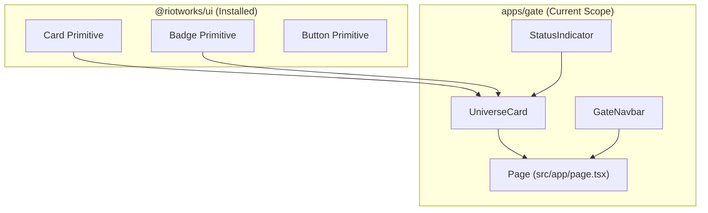

# Architecture & Design Decisions: Gate UI Components

## 1. Context & Motivation

MOONWITNESS features 9 ecosystem experiences. `apps/gate` serves as the public entrance and universe catalog.
To avoid merge conflicts with active PRs (#190, #193) in `packages/ui`, components are incubated in `apps/gate/src/components/` following the _App-First Component Incubation_ pattern.

## 2. Component Architecture

## 3. Promotion Strategy to `packages/ui`

Once PR #193 (`feat-moonwitness-skin-engine`) merges into `main`, `StatusIndicator` and `UniverseCard` will be extracted into `packages/ui/src/components/` and exported via a dedicated small PR.
