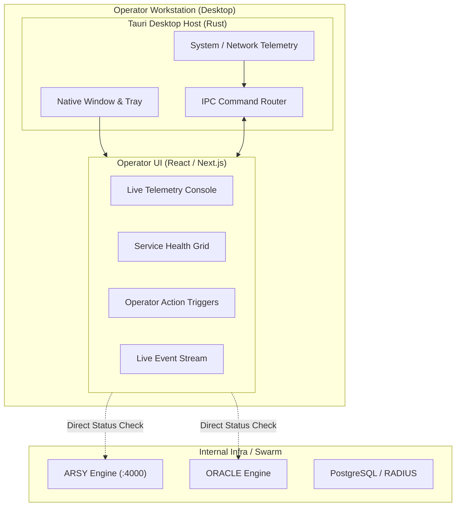

# Architecture & Design: COCKPIT Desktop Runtime

## 1. System Topology

## 2. Port Allocation

- `apps/headquarter`: `3000`
- `apps/gate`: `3001`
- `apps/cockpit`: `3002` (Web Preview) & Desktop Window
- `apps/arsy`: `4000`
