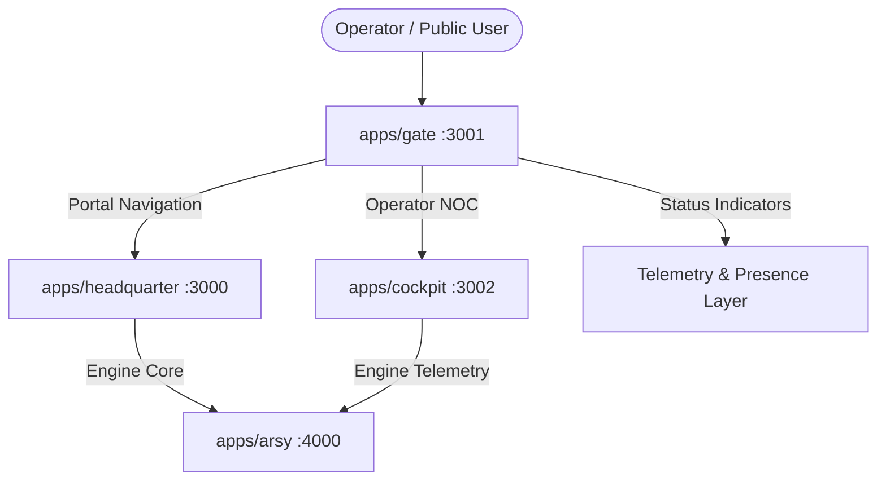

# Architecture & Design: Gate Universe Navigation

## Overview

`apps/gate` serves as Experience 01 in the MOONWITNESS Universe registry. It provides the landing discovery interface for all 9 defined product experiences:

1. Gate (Public Gateway / Portal)
2. Dock (Community Domain)
3. Headquarter (Strategic Command / Governance)
4. MOONWITNESS ID (Identity Authority)
5. World Observatory (Research & Knowledge Fabric)
6. Moonsky (Messaging & Signal Network)
7. Harbor (Subscriber Operations Domain)
8. Cockpit (Infrastructure & Real-time NOC)
9. E-ISP Storefront (Public Connectivity Storefront)

## Context Diagram

## Decisions & Trade-offs

- **Real-world Operational Wiring**: Cockpit is now fully active with desktop Tauri v2 runtime and Next.js web NOC at port 3002. Headquarter operates at port 3000. Gate links must resolve directly to these working applications while properly classifying Target/Future experiences.
- **Resilient UI State**: Experiences not yet deployed default cleanly to their architectural role and target status without fake mock buttons or deceptive success states.
