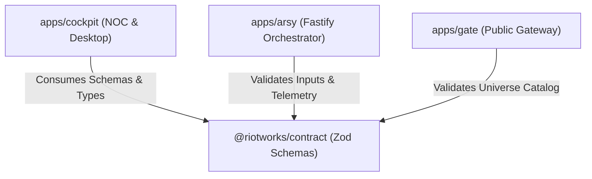

# Architecture & Decisions: Shared Contracts

## Module Boundary

`@riotworks/contract` serves as the cross-cutting contract boundary in the monorepo:

## Decisions

- Export both raw Zod schemas and TypeScript types (`z.infer<typeof ...>`).
- Implement contract tests in `@riotworks/contract/tests/*.test.mjs` verifying schema invariants.
- Ensure package can be imported via `"main"` or `"exports"` in package.json.
