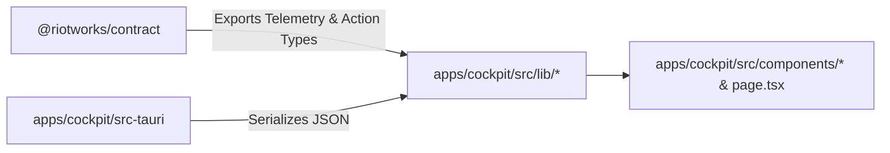

# Architecture & Design: Contract Consumer in Cockpit

## Relationship

## Decisions

- Add `"@riotworks/contract": "workspace:*"` to `apps/cockpit/package.json`.
- Replace local interface duplicates in `apps/cockpit/src/lib/telemetry.ts` and `apps/cockpit/src/lib/actions.ts` with imports from `@riotworks/contract`.
- Ensure tests run cleanly with zero syntax warnings.
