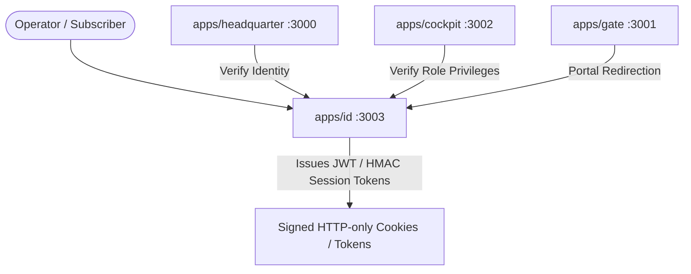

# Architecture & Design: Apps ID Foundation

## Overview

`apps/id` acts as Experience 04 (Authority for human and service identities, session verification, and access visibility).

## Architecture Context

## Contracts & Ports

- Gate: `3001`
- Headquarter: `3000`
- Cockpit: `3002`
- ID: `3003`
- ARSY: `4000`
